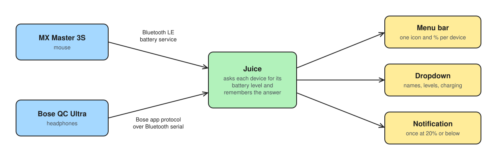

# Juice

Battery levels for a Logitech MX Master 3S mouse and Bose QuietComfort Ultra headphones, in the macOS menu bar.



## What you get

- **Menu bar:** each connected device gets its own item with an icon and a percentage. When a device disconnects, its item fades out. When it reconnects, the item fades back in.
- **Dropdown:** click either item to see both devices, their levels, and whether they are charging.
- **Low battery alert:** one notification when a device reaches 20%. The alert can fire again once the device has charged past 25%.

## Install

You need an Apple silicon Mac on macOS 26 or later, with Xcode's command line tools (Swift 6.2).

```sh
make install
```

This builds Juice, signs it, copies it to `/Applications`, and launches it.

On first launch macOS asks for Bluetooth access and Juice asks to send notifications. Allow both. To start Juice with your Mac, tick **Open at Login** in the dropdown.

## Use your own device names

Juice finds each device by its Bluetooth name. The defaults are `MX Master 3S` and `Atom`. Change them, then relaunch Juice:

```sh
defaults write ai.pivotstudio.juice mouseName "MX Master 3S"
defaults write ai.pivotstudio.juice headphonesName "Atom"
```

After you rename or re-pair the headphones, clear the address Juice saved for them:

```sh
defaults delete ai.pivotstudio.juice headphonesAddress
```

## How it works

**Mouse.** The MX Master 3S reports its battery through the standard Bluetooth LE battery service. Juice reads it directly and re-reads it every minute.

**Headphones.** macOS does not report the Bose battery anywhere, so Juice asks the headphones itself. It uses the same protocol as the Bose app (called BMAP) over a Bluetooth serial connection, and asks again every 2 minutes. The message format comes from the open-source [bosectl](https://github.com/aaronsb/bosectl) project.

**Disconnects.** A device going away is normal, not an error. Its item leaves the menu bar and Juice waits. Juice notices the headphones return when they show up as an audio device, and connects a second later. If that connection fails, Juice retries after 2 seconds and doubles the wait each time, up to 5 minutes.

Juice only talks to the headphones while they are already connected to this Mac, so it never pulls them away from your phone.

## Check that it is working

```sh
make probe
```

This prints one reading per device as JSON. It exits with an error if either device has no reading.

To see each step of the headphones connection:

```sh
JUICE_TRACE=1 ~/Library/Caches/JuiceBuild/Juice.app/Contents/MacOS/Juice --probe
```

## For developers

```sh
make test     # tests for the Bose message decoder
make app      # build the signed app without installing it
make clean    # remove build output
```

Build output goes to `~/Library/Caches/JuiceBuild`. The source of the diagram is `docs/how-it-works.excalidraw`, which opens in [Excalidraw](https://excalidraw.com).

Three things about macOS shaped the code:

- **macOS animates the menu bar itself.** It fades a menu bar item in or out and slides its neighbours whenever the item is inserted, removed, or resized. Juice only inserts or removes each device's item and leaves the animation to macOS. Animating the item by hand fights the system animation and stutters.
- **macOS can report the headphones as disconnected when they are not.** On macOS 27.2, listing paired Bluetooth devices makes the system report these headphones as disconnected for the rest of that process. Juice instead treats them as connected while they appear as an audio device, and looks up their Bluetooth address in a separate short-lived process (`Juice --resolve-address <name>`).
- **macOS loses track of the mouse.** It lists the mouse as a power source but drops it from that list for long stretches while the mouse stays connected. Juice uses that list only for the charging flag.
